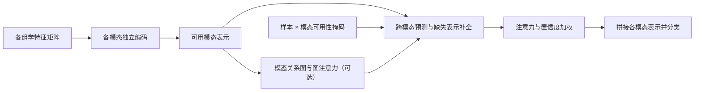

# CAGEF

CAGEF 用多组学数据进行样本分类，并支持模拟部分样本缺少整种组学测量的情形。模型先将各组学映射到共同维度，利用同一样本内的模态关系估计缺失表示，再按置信度融合各路信息，输出类别分数。

## 模型如何工作



- **编码与建图。** 各模态可以有不同的输入特征数。启用图网络时，模型为每个样本构建一张图，节点代表该样本的不同模态，图注意力用于提取模态间的关系。
- **缺失补全。** 模型根据可用模态预测缺失模态的隐空间表示，并估计预测的置信度。将 `--missing_rate` 设为 `0` 会跳过补全；此时仍可启用图网络处理完整样本。
- **融合与训练。** 每路表示经过注意力和置信度加权后拼接，送入分类器。训练以分类损失为主，并按配置加入补全损失、模态一致性损失和图一致性损失。

## 快速开始

在项目根目录（含 `CAGEF.py`）打开终端。下列 CPU 环境已通过 ROSMAP 两折短实验验证。使用 Python 3.9.13 环境安装依赖：

```shell
python -m pip install torch==2.4.1 --index-url https://download.pytorch.org/whl/cpu
python -m pip install numpy==1.24.4 scikit-learn==1.0.2 tqdm==4.64.1
```

仓库中的 `requirements.txt` 同时记录了 pip 和 Conda 格式的依赖，并列出两个 pandas 版本。上面的命令给出了训练入口直接使用的第三方库。使用 GPU 时，需安装与机器匹配的 CUDA 版 PyTorch。

**先验证流程。** 下面的命令读取随附的 ROSMAP 数据，在 CPU 上训练两折，每折一轮，并生成预测与汇总文件。

```shell
python CAGEF.py --data_folder ROSMAP --device cpu --num_runs 1 --num_folds 2 --num_epoch 1 --test_interval 1
```

**运行默认实验。** 以下命令在 BRCA 上进行 10 次独立重复，每次在开发集上做分层五折交叉验证，每折最多 2,000 轮。默认请求 CUDA，CUDA 不可用时回退到 CPU。

```shell
python CAGEF.py --data_folder BRCA
```

| 常用参数 | 默认值 | 用途 |
| --- | --- | --- |
| `--modalities` | 自动发现 | 选择参与实验的模态，例如 `--modalities "1,3"`。至少选择两种。 |
| `--missing_rate` | `0.1` | 在开发集和测试集中分别抽取约 10% 的样本，遮蔽每个入选样本的一部分模态。每个样本至少保留一种。 |
| `--use_gnn` | `1` | 用 `0` 关闭图网络，可在相同数据与随机种子下比较其影响。 |
| `--num_runs` / `--num_folds` | `10` / `5` | 设置独立重复次数和每次交叉验证的折数。每个训练类别的样本数至少等于折数。 |
| `--num_epoch` / `--test_interval` / `--patience` | `2000` / `50` / `15` | 每折最多训练的轮数、验证间隔，以及早停等待的验证次数。 |
| `--seed` / `--seed_step` | `58` / `100` | 设置首次实验的基础种子及后续每次重复的种子增量。 |
| `--exp` | `./exp` | 设置结果根目录。每次启动会创建带时间戳的子目录。 |

运行 `python CAGEF.py --help` 可查看优化器参数、网络维度、损失权重及其他选项。

## 数据格式

仓库包含以下四个数据集，均提供前缀为 `1`、`2`、`3` 的三路模态。开发集来自 `*_tr.csv`，预留测试集来自 `*_te.csv`。

| 目录 | 开发集样本 | 测试集样本 | 类别数 |
| --- | ---: | ---: | ---: |
| BRCA | 612 | 263 | 5 |
| KIPAN | 460 | 198 | 3 |
| LGG | 357 | 153 | 2 |
| ROSMAP | 245 | 106 | 2 |

BRCA 的任务是乳腺癌 PAM50 亚型分类，ROSMAP 的任务是区分阿尔茨海默病患者与正常对照。标签含义见 [BRCA 数据说明](BRCA/README.md) 和 [ROSMAP 数据说明](ROSMAP/README.md)。

接入自己的数据时，为每种模态准备一对 `<模态名>_tr.csv` 和 `<模态名>_te.csv`，并提供 `labels_tr.csv` 和 `labels_te.csv`。每个特征文件均为无表头的纯数值矩阵，行是样本，列是特征。同一模态的训练和测试文件须使用相同的特征列及顺序。每个划分内，各模态和标签按相同的样本顺序排列，标签每行一个整数，测试类别需在开发集中出现。随附的 `*_featname.csv` 供查阅特征名称，训练入口只读取矩阵和标签。

缺失实验从数值完整的矩阵出发，由程序生成样本级掩码。输入矩阵中的空值、NaN 和 Inf 会导致读取失败。

## 如何读取结果

每折仅用该折训练样本估计归一化参数。默认按验证集指标选择检查点，二分类使用 AUC，多分类使用宏平均 F1。每次独立实验将各折模型在同一预留测试集上的预测概率取平均，再计算该次测试指标。

| 输出文件 | 内容 |
| --- | --- |
| `repeated_test_results.csv` | 每次独立实验的预留测试集指标，以及跨重复的均值和标准差。二分类报告 ACC、F1、AUC，多分类报告 ACC、加权 F1 和宏平均 F1。 |
| `repeated_config.json`、`repeated_summary.json` | 整组实验的参数、随机种子和汇总结果。 |
| 每次运行目录下的 `summary.json`、`predictions.npz` | 单次实验的评估摘要，以及开发集折外预测、测试集集成概率、标签、折号和模态掩码。 |
| 每折目录下的 `checkpoint.pt` | 该折按验证指标选出的模型权重。 |

## 代码入口

| 文件 | 职责 |
| --- | --- |
| [CAGEF.py](CAGEF.py) | 命令行入口，解析参数、调度重复实验并写出汇总表。 |
| [data.py](data.py) | 发现模态文件、读取数据、生成缺失掩码并对可用模态做噪声增强。 |
| [model.py](model.py) | 实现模态编码、关系图、跨模态预测、置信度加权和分类损失。 |
| [trainer.py](trainer.py) | 执行分层交叉验证、折内预处理、训练、检查点选择及测试集成。 |
| [utils.py](utils.py) | 提供随机种子、设备选择、张量检查和数值计算工具。 |
